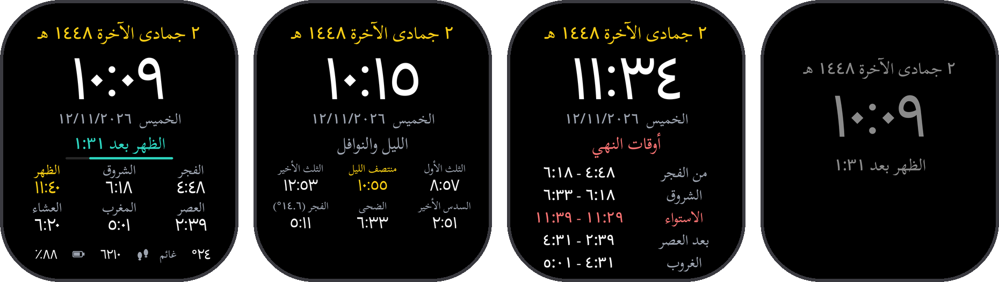
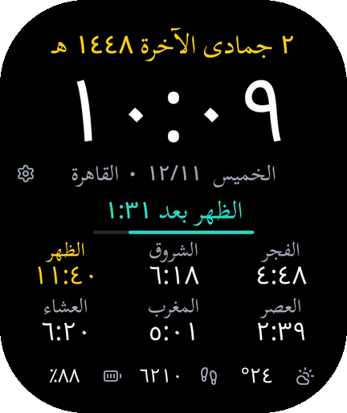
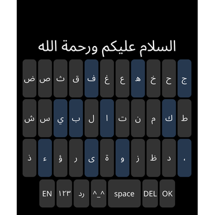
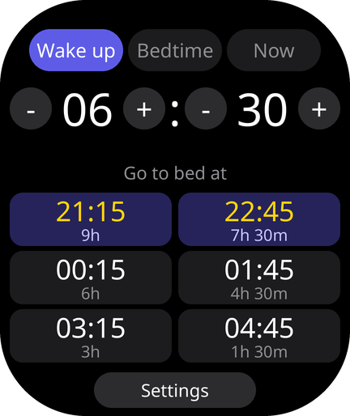

# Zepp OS Muslim apps

Offline Zepp OS apps for the **Amazfit Bip Max**, built to work with Gadgetbridge (no phone needed). The watchface also runs on 24 other rectangular and round Zepp OS 3+ watches, such as the Bip 6, Active 2, Balance, T-Rex 3 and GTR 4.



| Project | | |
|---|---|---|
| [Prayer-times watchface](prayer-times-watchface/README.md) | Hijri date, next prayer countdown, iqama, night and prohibited times; Arabic, English, French, Turkish, Indonesian, Malay, Russian |  |
| [Location companion](prayer-location-app/) | Shares a GPS fix with the watchface | |
| [Daad keyboard](daad-keyboard/README.md) | Arabic and English keyboard with long-press variants, digits and tashkeel, ready phrases; Arabic shown in the right order while typing |  |
| [Sleep Time](sleep-time/README.md) | Sleep-cycle calculator: when to go to bed or wake up, with its own alarm; Arabic and English |  |

**Download:** the latest `.zab` of each app is in [RELEASES.md](RELEASES.md).

## Build

Tools are managed by [mise](https://mise.jdx.dev) (a [monorepo](https://mise.jdx.dev/tasks/monorepo.html): shared tools at the root, tasks per project).

```sh
mise install --monorepo
mise run //prayer-times-watchface:build   # → prayer-times-watchface/dist/*.zab
mise run simulator                        # Zepp OS simulator (macOS)
```

Install a `.zab` by opening it with Gadgetbridge, or via the Zepp app's Developer Mode (`zeus preview`).

Shared between projects: the root `mise.toml` (tools, the Python commands, and the `zeus-build`, `zeus-store` and `zeus-ci` task templates each app's `:build`, `:build-store` and `:ci` extend), `devices.json` (every screen and its watches' device ids, from which `:gen` writes each app's `app.json` targets), `scripts/` (app IDs, targets, the generated-files check, font downloads into `.cache/fonts/`) and `shared/` (text and widget drawing for the image generators: HarfBuzz shaping, FreeType, the Unicode bidi algorithm; the mini apps' stub `@zos` modules and package test). A change to any of them rebuilds every project in CI.

## License

[GPL-3.0](LICENSE). Bundled: an Arabic font under SIL OFL 1.1 ([details](prayer-times-watchface/README.md#font)), [adhan-js](https://github.com/batoulapps/adhan-js) (MIT), icons from [Lucide](https://lucide.dev) (ISC), and a city list from [GeoNames](https://www.geonames.org/) (CC-BY 4.0) with Arabic names from Wikidata (CC0) and country names from CLDR (Unicode License).
