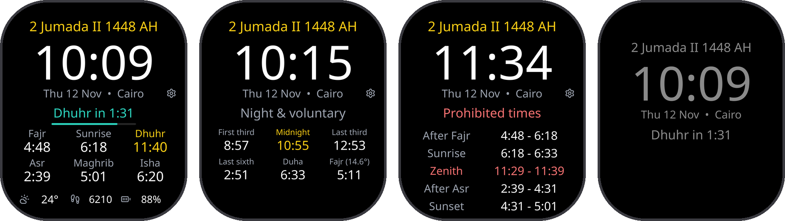
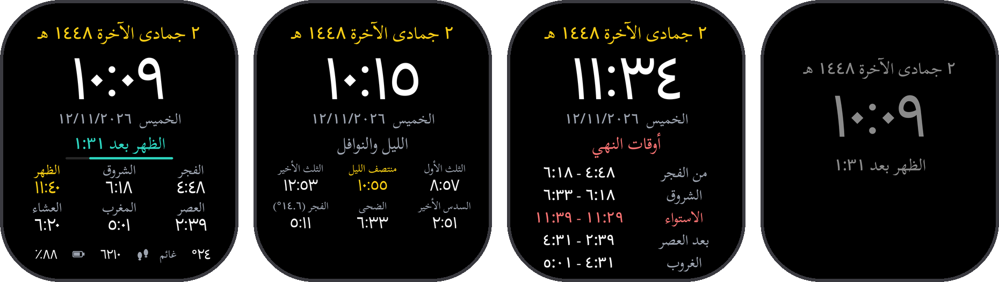
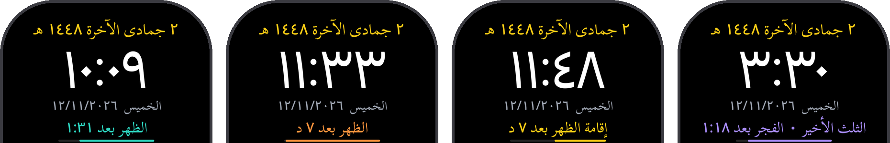
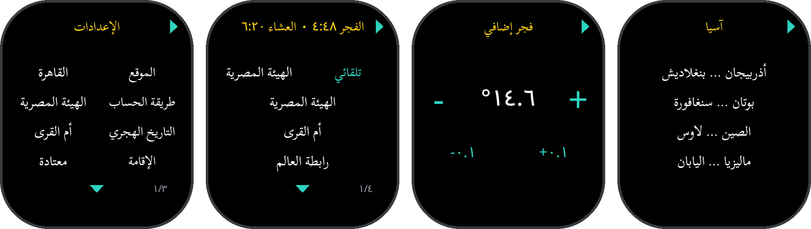
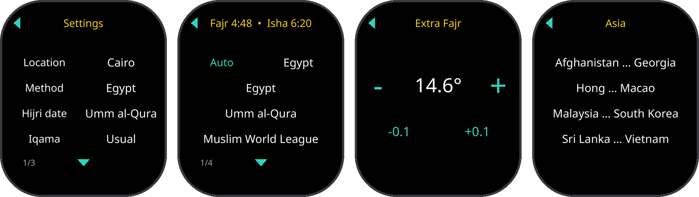

# Prayer Times watchface — Amazfit Bip Max and other Zepp OS watches

An offline Zepp OS watchface for the Bip Max (432×514) and 24 other rectangular and round Zepp OS watches (see [Devices](#devices)). It shows:
- the time
- the Hijri date (Umm al-Qura)
- the Gregorian date and the place the times are for
- the next prayer with a countdown
- all six times, with the next one highlighted

Everything is computed on the watch. It needs no phone, app-side code or network, so it works with Gadgetbridge.

It's in Arabic, English, French, Turkish, Indonesian, Malay and Russian, following the watch's language or one picked in its menu. Arabic is laid out right to left; the other languages get the mirror image:





*Left to right: prayers (default page), night and voluntary prayers, prohibited times (the current window in red), always-on display.*



*Countdown line: normal, last 10 minutes before an adhan, waiting for iqama, last third of the night.*

Screenshots are rendered from the face's own layout and prayer logic (`tools/gen-docs.py`) for Cairo on 12 Nov 2026, so they match what the watch shows.

## Pages (tap the prayer grid to cycle; waking the screen returns to page 1)

1. **Prayers:** a 2×3 grid (Fajr, Sunrise, Dhuhr / Asr, Maghrib, Isha; Dhuhr becomes الجمعة on Fridays). The next prayer is gold, with a countdown above.
   - **Countdown line colours:** teal normally, orange in the last 10 minutes before an adhan, gold while waiting for an iqama, and violet in the last third of the night, when it reads "الثلث الأخير • الفجر بعد …".
   - **Progress bar** under the countdown: fills in reading direction from the previous adhan to the next one (or from adhan to iqama), in the countdown's colour.
   - **Extras row** underneath: three cells, each chosen in its own edit slot from weather, steps, heart rate, battery, calories or nothing. Defaults are weather, steps and battery.
   - **Weather:** the current condition as an icon and the temperature, both drawn by the firmware from the phone's weather (`IMG_LEVEL` + `WEATHER` with one icon per Zepp weather code, and `TEXT_IMG` + `WEATHER_CURRENT`). The face's icons (weather, steps, heart rate, battery, calories, the settings gear) are from [Lucide](https://lucide.dev) (ISC, `fonts/LICENSE-lucide.txt`), mapped in `tools/render.py` (`WEATHER_ICONS`, `ICONS`). With no weather from the phone (e.g. Gadgetbridge without Breezy Weather), the cell stays empty.
   - **Heart rate:** shows the last measurement, and is hidden until there is one.
2. **الليل والنوافل (night and voluntary prayers)**, in the same 3-column grid:
   - night portions between Maghrib and the next Fajr: first third, midpoint, last third, last sixth
   - Duha
   - on 1 Shawwal and 10 Dhul-Hijjah, the Eid prayer window (sunrise + 15 min until noon) instead of Duha
   - optional extra Fajr / Isha at angles you set in the face menu (12°–20°, in 1° or 0.1° steps, e.g. 14.6°). An extra equal to the method's own angle is hidden, e.g. 12° under UIOF.
3. **أوقات النهي (prohibited times):** from Fajr, sunrise to sunrise + 10/15/20 min, the minutes before noon, after Asr, and from the sun at +5° to sunset. The current window is red.

The event definitions follow the Suntimes Prayer Times add-on (`AddonEvents.kt`, `DaysMonthBuilder.kt`).
- **Asr school** (face menu → العصر): the majority (shadow ratio 1×, 10 minutes before noon) or Hanafi (2×, 5 minutes).
- **High latitudes** (face menu → خطوط العرض العليا): far from the equator the sun can stay above 18° below the horizon all summer night, so the method's Fajr / Isha don't exist or come absurdly late. They're then capped at a portion of the night from sunrise / sunset:
  - **automatic** (default): the seventh of the night above 48° (north or south), the middle below. A seventh at lower latitudes could cap a normal Fajr (Cairo's summer nights are short enough), so it isn't used there.
  - **middle of the night**, **seventh of the night**, or **twilight angle** (the angle / 60 of the night, 0.3 for 18°).
  - In London at midsummer these give Fajr over an hour apart. Moonsighting Committee applies its own rule at 55° and above.

**Iqama:** between a prayer's adhan and its iqama, the countdown line turns gold and reads "إقامة العشاء بعد ٧ د" (iqama of Isha in 7 min). The prayer stays highlighted until the iqama.
- **Minutes** are set per prayer in the face menu (الإقامة); 0 = no iqama countdown for that prayer. The "قالب" row fills them from a preset (Fajr, Dhuhr, Asr, Maghrib, Isha):
  - none
  - short: 10, 10, 10, 5, 10
  - standard: 20, 15, 15, 10, 15
  - long: 30, 20, 20, 10, 20
- **Jumu'ah:** Friday Dhuhr uses its own iqama minutes (0 = no countdown).

**Methods** (face menu → طريقة الحساب): Egyptian, Umm al-Qura, MWL, Karachi, ISNA, Dubai, Kuwait, Qatar, Singapore, Turkey (Diyanet), Tehran, UIOF (12°/12°), Moonsighting Committee, or **Custom** (مخصصة, the last row): your own Fajr angle and, by the Isha mode row (العشاء حسب), an Isha angle (10°–22°, 1° and 0.1° steps) or Isha a number of minutes after Maghrib (60–150, 5 and 1 minute steps, starting at Umm al-Qura's 90). Picked the first time, Custom starts from the method in use. The method screen's title shows today's Fajr and Isha with the highlighted method, so you can compare before closing.
- **Automatic** (the default) picks the method from the country of the city picked on the face (`lib/methods.js`): Umm al-Qura for Saudi Arabia, Yemen, Bahrain and Oman; Egyptian for Egypt, Sudan, Libya and the Levant/Iraq; Karachi for Pakistan, India, Bangladesh and Afghanistan; Singapore for Malaysia, Indonesia and Brunei; Turkey, Tehran, Dubai, Kuwait, Qatar, ISNA (US/Canada), UIOF (France), Moonsighting Committee (UK); MWL everywhere else. The companion app's GPS fix has no country, so it keeps the last picked city's (Egypt until one is picked).

## How it works

```
config.js defaults ───────────┐
face menu (own storage) ──────┤
edit-slot choices (looks) ────┼──► settings S (method: auto → by country; 12/24h: the watch's)
lat/lon/country (city / app) ─┘        │
                                       ▼
Time sensor ──► date + timezone ──► dayEvents() × yesterday / today / tomorrow   lib/prayer.js
                                       │  cached until date, location, timezone, method or 12/24h change
                                       ▼
                 countdown(now) ──► next prayer, iqama, progress, colour         lib/countdown.js
                 hijriFromEpochDay ► Hijri date                                  lib/hijri.js
                                       │
                                       ▼
                 widgets: normal layer (3 pages) + AOD layer                     watchface/index.js
```

**Lifecycle** (`watchface/index.js`):
- **`build()`** runs once, when the face loads or after Edit:
  - reads the edit-slot choices
  - creates page 0, the tap areas, the AOD layer and the edit slots (pages 1–2 and the menu are created on first use). The always-on screen runs its own instance (`getScene() === SCENE_AOD`), which creates only the edit slots and the 4 AOD texts.
  - runs a full refresh
- **Every minute:** `Time.onPerMinute` updates the clock, Hijri date, countdown, progress bar and colours, the extras row, and whichever page is visible. Prayer events come from the cache. Every text, colour and visibility write goes through `setText` / `setColor` / `show`, which skip values that haven't changed, so a typical minute costs ~4 widget writes (2 on the always-on screen) instead of ~70.
- **New day:** `Time.onPerDay` forces a full refresh.
- **Wake:** a `WIDGET_DELEGATE` `resume_call` returns to page 1 and runs a full refresh. Timers don't fire while the screen is off, so this catches up the minutes and re-reads the location. The picked city is kept in memory.
- **Full refresh:** re-reads location, timezone and the watch's 12/24h setting, re-resolves the settings, and only recomputes events when the date, location, timezone, method or clock format has changed. Waking normally costs no prayer maths.

**Settings:** `S = config.js defaults ← face settings ← Edit-slot values` (`lib/settings.js`), plus lat/lon from the city or coordinates picked on the face, or the location app (whichever was set last). Each setting has one home:
- **Face menu** (tap the date line, marked with ⚙): **what the face calculates.** Location (a city, or coordinates in 1° and 0.1° steps), method (automatic by country, one of 13, or custom angles / Isha minutes), Asr school, high-latitude rule, Hijri offset (−2…+2) and day start, iqama minutes per prayer plus Jumu'ah (0–60, with presets), extra Fajr/Isha angles (12°–20°, 1° and 0.1° steps), sunrise window (10/15/20 min), per-prayer minute adjustments (±30), 12/24h (follows the watch by default, `getTimeFormat()`) and the language. The first page holds location, method, Hijri and iqama. Values are saved as one JSON in the face's `LocalStorage` (a file in its data folder on API 3.5 watches, which have no `LocalStorage` in faces) and applied when the menu closes; `config.js` only holds their defaults.
- **Edit slots** (long-press → Edit): **how it looks.** Digits and the three extras cells. Changing a slot rebuilds the face.



**Face menu:** `watchface/menu.js` is a generic overlay whose widgets are created on the first tap (not in `build()`) and reused for every screen; `watchface/screens.js` defines the screens. While it's open the page and date tap targets are hidden; waking the screen closes it.
- **Lists:** 4 rows of 68 px that touch, so every pixel of a row is tappable. ▲ / ▼ page through, with a counter (٢/٥) next to ▼. Back is the title row, marked ▶ (it closes the menu at the top level). Nothing tappable sits in the bottom ~60 px: taps there got mistaken for the watch's swipe-up gesture.
- **Values** (iqama minutes, angles, coordinates, adjustments, Hijri offset): the row opens a value screen with the number large in the middle and big − / + buttons on either side; angles and coordinates add a 0.1° row underneath.
- **Long location lists** (over 3 pages) open on an index of 4 ranges named by their first and last entry ("أذربيجان … بنغلاديش"); a range that's still long gets its own index, so Punjab's 117 cities take 2 index taps and at most 2 pages.
- **Language:** automatic (the watch's language from `getLanguage()`; English when the face doesn't have it) or one of the seven, each listed in its own name. Picking one closes the menu and rebuilds the face's widgets in it.
- **Feedback:** the pressed row or button flashes dark grey (one shared highlight `FILL_RECT`, moved under the tap area on touch down).

**Pages:** pages 1 and 2 are created on the first tap away from page 0 (most face loads never leave it); after that, switching pages only toggles visibility. Widgets created later sit on top and take the taps, so the lower half's tap areas are recreated above the new pages, and opening the menu returns to page 0 first. An invisible tap area over the grid and extras row cycles the pages. On page 0, tapping weather opens the Weather app, steps or calories open Activity, and heart rate opens Heart Rate (`launchApp` with the API 3.0 system app IDs). The battery cell just cycles the pages. Tap areas are `IMG`s with a size and no image, with `CLICK_DOWN`/`CLICK_UP` listeners, so no images are needed (alpha-0 `FILL_RECT`s, used before, are drawn black on API 3.5 firmware). Only a quick, still tap counts, so a long press still opens the face picker.

**Languages:** `lib/i18n/<lang>.js` holds every string the face shows, with the same keys as `ar.js` (`test/verify.mjs` checks the keys and shapes). Templates are functions, so each language keeps its own word order (`nextIn('Dhuhr', '1:31')` → "Dhuhr in 1:31", "Öğle vaktine 1:31"). `tools/gen-i18n.mjs` turns each into `assets/<target>/i18n/<lang>.json` (functions become templates such as `"{0} in {1}"`), and the face reads only the chosen language's file (`lib/i18n/load.js`); the tests check the files give the same text. `lib/i18n/text.js` builds the face's lines from them, and the docs generators use it too. The layout is written for right to left, and `box()` in `watchface/index.js` mirrors every rectangle for the other languages. Arabic uses the bundled Naskh font; the others use the system font. The watch has no Urdu or Persian, so they aren't offered. The translations other than Arabic and English need a native speaker's review.
- **Changing language** rebuilds every face widget (`relayout()`, deferred to after the tap that triggered it). The Edit slots, their previews and the digits default are set when the face loads, so they follow a new language after the face reloads (e.g. after editing it).
- **Digits:** Arabic-Indic by default in Arabic, Latin in the other languages; the Digits Edit slot overrides either.



**Date line:** "Thu 12 Nov 2026", or with a place "Thu 12 Nov  •  Cairo": the year is dropped then (the Hijri line above has one), since the line beside ⚙ is only 336 px. A place that still doesn't fit is cut with "…"; typed-in coordinates fall back to whole degrees instead ("34,-118"), and the menu's Location row shows them exactly.
- **Measuring:** the watch can't measure text in our font, so `lib/i18n/text.js` adds up estimated character widths from `lib/text-width.js`. `tools/gen-text-width.py` generates them by shaping every date and city name with HarfBuzz, in the bundled Naskh font for Arabic and in Noto Sans as a stand-in for the system font. Letters get a 15% (Naskh) or 3% (system font) margin. A cut Arabic name gets 6 px more, because its last letter takes its wider final form.
- **Check:** the generator builds every city's date line on each language's three widest dates with the face's own code. It fails if any line is wider than the box in the real font. On those dates, 13–30% of city names are shortened, depending on the language. The menu's Location row shortens long names the same way.

**Always-on display:** a separate `ONLY_AOD` layer shows the Hijri date, the time, the Gregorian date line and the next-prayer line in dim grey with no fills (few lit pixels). It's updated by the same refresh as the normal layer.

**Weather:** the condition icon and the temperature are drawn by the firmware, so the face's code reads no weather. An earlier version read today's forecast (the legacy `hmSensor` weather sensor) for a condition word, which didn't show on the Bip Max.

## Font

In Arabic, text (dates, names, labels) uses **Prayer Face Naskh**, a 64 KB subset of SIL's [Scheherazade New](https://software.sil.org/scheherazade/) 4.500 Medium. The clock and times stay in the system font, and `arabicFont: null` in `config.js` switches everything back to it.
- **Digits:** the font's digits (Latin and Arabic-Indic) and the punctuation around them (`/ : . % ° ٪`) come from [Noto Sans / Noto Sans Arabic](https://fonts.google.com/noto) Medium (OFL 1.1). Every number on the face is then sans, matching the system-font clock and times, instead of mixing in Scheherazade's serif numerals.
- **Presentation forms:** Zepp OS shapes Arabic by converting letters to Arabic Presentation Forms-B code points. Scheherazade has none of these, so `tools/gen-font.py` adds them, built with HarfBuzz from the font's own shaping. Lam-alef and similar forms are composite glyphs.
- **License:** Scheherazade New is under the SIL Open Font License 1.1. A subset counts as a Modified Version and "Scheherazade" / "SIL" are Reserved Font Names, so the subset is renamed. SIL's copyright and license records stay inside the font, and the license text is in `fonts/OFL.txt` (Noto's copyright is in `fonts/NOTICE`). Noto Sans is from google/fonts `ofl/notosans` and `ofl/notosansarabic`.
- **Adding new Arabic text:** the subset only contains the Arabic-script characters found in `watchface/`, `lib/`, `lib/i18n/ar.js` and the city files, so a new string can show missing glyphs. Regenerate it after adding one:
  `mise run :gen` (or `:build`).

## City list

`assets/<target>/cities/` holds **4,997 cities in 241 countries** (161 KB): `index.json` (world regions → countries) plus one `<CC>.json` per country, either `{cities: [[name, lat, lon], …]}` or `{regions: [[region, [[name, lat, lon], …]], …]}`, with lat/lon in whole hundredths of a degree (~1 km, under 3 s of prayer time). The face menu reads them with `@zos/fs` only when you open the location screens, so they cost nothing at startup.
- **Source:** [GeoNames](https://www.geonames.org/) `cities15000` (CC-BY 4.0). Arab League countries keep every city ≥ 15k people, other Muslim-majority countries ≥ 50k, the rest of the world ≥ 250k, plus every capital.
- **Arabic names:** GeoNames `alternateNamesV2`, then the Arabic label of the place's Wikidata item (CC0) where GeoNames has none. Diacritics are dropped, and Persian letter forms are mapped to Arabic ones (ی→ي, ک→ك, ڤ→ف). A name is kept only if the font shapes every letter; otherwise the plain-ASCII English name is used. About 54% of cities, all countries and most governorates have Arabic names. The Maghreb has the most gaps (Morocco ~25%). Fixes go in `OVERRIDES` in `tools/gen-cities.py`.
- **Other languages:** cities and regions show their plain-ASCII GeoNames name (stored only where it differs from the Arabic one), sorted on the watch. Country names come from [CLDR](https://cldr.unicode.org/) via Babel, one per language in `index.json`.
- **Navigation:** countries with more than 15 cities get a governorate/state step. Lists are alphabetical, ignoring a leading "ال". Admin prefixes like "محافظة" are dropped.
- **Regenerate:** `mise run :gen-cities` downloads ~210 MB from GeoNames (it changes daily, so this isn't part of `:build`). It queries Wikidata once for missing names (cached in `.cache/geonames/`), rewrites the files and regenerates the font. The output is committed.
- **Reading on the watch:** `lib/city-data.js` tries `readFileSync('assets://…')` (API 3.0) first, then `openAssetsSync` + `readSync` with a small UTF-8 decoder (`lib/utf8.js`).

## Layout

```
watchface/index.js         ← UI (normal + AOD + edit slots), lifecycle and refresh (see How it works)
watchface/menu.js          ← face menu overlay (rows, steppers, paging, back)
watchface/screens.js       ← face menu screens: location (city or coordinates), high latitudes, adjustments, iqama, angles, 12/24h, sunrise window
config.js                  ← defaults (fallback location, and defaults for the face-menu settings)

lib/layout.js              ← every box the face draws: the Bip Max design scaled to rectangles, a round design scaled to circles
lib/text-width.js          ← GENERATED estimated character widths, to shorten long place names (tools/gen-text-width.py)
lib/prayer.js              ← adhan-js wrapper (npm, MIT, bundled by zeus) → local minutes; night portions, makruh windows
lib/countdown.js           ← countdown line: next prayer, iqama, progress, last 10 min, last third of the night
lib/hijri.js               ← Hijri conversion (Umm al-Qura table + tabular fallback)
lib/hijri-table.js         ← GENERATED month-length table, 1440–1500 AH
lib/settings.js            ← face settings: defaults, sanitizing, steppers, iqama presets, precedence with edit slots
lib/methods.js             ← method order for the menu and the automatic method by country
lib/i18n/                  ← strings per language (ar.js is the reference), language choice, face lines (text.js), loading one language on the watch (load.js)
lib/store.js               ← JSON values in the face's LocalStorage, or files in its data folder where a face has no LocalStorage (API 3.5)
lib/location.js            ← newest of the picked city / coordinates and ../prayer-location-app's fix
lib/app-ids.js             ← generated: the companion's appId, from the root mise.toml [env]
lib/city-data.js           ← reads the city files on demand (@zos/fs); lib/utf8.js decodes them
assets/<target>/cities/    ← GENERATED city list: index.json + one <CC>.json per country (tools/gen-cities.py)
assets/<target>/i18n/      ← GENERATED strings per language, read by the face (tools/gen-i18n.mjs)
assets/<target>/NOTICE.txt ← license and third-party notices shipped in the .zab (copy it for a new target)
store-listing.json         ← Zepp store names, descriptions and review notes per language (../.agents/skills/zepp-store-release)
lib/extras.js              ← extras-row sensors (steps, heart rate, battery, calories)
lib/weather-icons.js       ← GENERATED weather icon per Zepp weather code (tools/gen-edit-assets.py)
lib/edit-options.js        ← GENERATED on-watch edit slots (tools/gen-edit-assets.py)

tools/gen-hijri-table.mjs  ← regenerates the Hijri table from Node's ICU calendar
tools/gen-i18n.mjs         ← writes assets/<target>/i18n/<lang>.json from lib/i18n/<lang>.js
tools/gen-edit-assets.py   ← edit-slot previews, runtime icons/digits and menu arrows per target, lib/edit-options.js
tools/gen-preview.py       ← renders assets/<target>/icon.png (picker preview, size from devices.json) from the real layout
tools/render.py            ← the face's drawing for the above (boxes from lib/layout.js via tools/layout-data.mjs); text via ../shared/text_draw.py
tools/layout-data.mjs      ← prints lib/layout.js's boxes for one devices.json target, for the Python generators
tools/gen-text-width.py    ← lib/text-width.js from every date-line string (tools/date-line-texts.mjs), then checks every city's date line fits
tools/preview-data.mjs     ← sample face data for the previews, computed by lib/
tools/gen-docs.py          ← README screenshots in ../docs/watchface/ (scenes from tools/docs-data.mjs)
tools/gen-cities.py        ← city list from GeoNames (`mise run :gen-cities`, not part of :build; tools/fetch-geonames.sh downloads ~210 MB)
tools/gen-font.py          ← builds the Naskh subset (see Font); ../scripts/fetch-fonts.sh downloads its pinned sources

test/verify.mjs            ← Hijri vs ICU; prayer wrapper vs adhan in Africa/Cairo; event windows; countdown logic; face-menu settings
```

## Devices

The face is designed on the Bip Max and scaled to the other rectangular watches with Zepp OS 3 or later; round watches get the same face in a round layout:

| Target | Screen | Watches (deviceSource) | Tested |
|---|---|---|---|
| `bip-max` | 432 × 514 | Bip Max (11206915) | on the watch |
| `square-390x450` | 390 × 450 | Bip 6 (9765120, 9765121, 10158337), Active 2 Square (10223872, 10223873, 10223875, 9830656, 9830657, 9830659), Active (8323328, 8323329), GTS 4 (7995648, 7995649), Cheetah Square (8257793) | simulator (Bip 6) |
| `square-320x380` | 320 × 380 | Bip 5 Unity (8782081, 8782088, 8782089) | simulator |
| `round-480` | 480 × 480 | Balance 3, Balance Ultra, Cheetah 2 Ultra, T-Rex Ultra 2, Active Max, T-Rex 3 Pro 48 mm, Balance 2, Balance 2 XT, T-Rex 3, Balance, Cheetah Pro | simulator (Balance) |
| `round-466` | 466 × 466 | Cheetah 2 Pro, Active 3 Premium, T-Rex 3 Pro 44 mm, Active 2 Round, GTR 4 | not yet |
| `round-454` | 454 × 454 | Cheetah Round, T-Rex Ultra | not yet |
| `round-416` | 416 × 416 | Falcon | not yet |
| `round-360` | 360 × 360 | Active Edge | simulator |

Device ids, corner radii and preview sizes are from Zepp's [device list](https://docs.zepp.com/docs/reference/related-resources/device-list/); ids that only the store lists (Active 2 Square's second set, Balance 2 XT, and extra ids for several round models) are from the store's device list; every id is in the repo's `devices.json`. Older watches (Bip 5, GTS 4 mini, GTS 3, Band 7, GTR 3, GTR Mini, T-Rex 2) have Zepp OS 1–2, below the face's API 3.0. The T-Rex Dual Solar (456 × 456) is in the store but not yet in Zepp's device list, so it isn't included.

How the targets work:

- The repo's `devices.json` lists every screen our apps use: size, shape, corner radius (for screenshots), picker preview size and the watches' device ids. The face's `app.json` names its targets, each a `devices.json` key and an `assets/<target>/` folder (`test/verify.mjs` checks the folders); `:gen` fills in each target's device ids (`../scripts/targets.py`).
- `lib/layout.js` holds every box the face, the AOD layer, the Edit slots and the menu draw, in two designs: the Bip Max's 432 × 514 for rectangles and a 480 × 480 one for circles (screens with width = height). Another rectangle gets the Bip Max design scaled: x by width, y by height, text and icons by the smaller of the two; at 432 × 514 nothing is scaled, so the Bip Max is drawn exactly as designed. A round screen gets the round design scaled evenly. It has the same pages, rows and menu with narrower boxes and smaller text, and `test/verify.mjs` checks that everything drawn stays inside the circle.
- `watchface/index.js` reads the screen size from `getDeviceInfo()` (it needs the `data:os.device.info` permission; without it the call fails and every screen gets the unscaled Bip Max layout), and the generators (`tools/render.py` through `tools/layout-data.mjs`) write every target's images from the same boxes, so previews and screenshots match each screen. The font, city list and `NOTICE.txt` are the same for every target and are copied into each folder.

To add a screen: add it to the repo's `devices.json` if it isn't there, add `"<key>": {}` to the `app.json` targets, copy `assets/bip-max/cities/` and `assets/bip-max/NOTICE.txt` into `assets/<target>/`, then run `mise run :build`. zeus packs one `.zpk` per firmware group into the `.zab`, each with only its own target's assets, so a watch installs about 300 KB whatever the number of targets. Rectangles far from the Bip Max's proportions would need a design of their own. To check a target's layout without a watch, `ZOS_TARGET=<target> DOCS_OUT=<folder>` with `tools/gen-docs.py` renders its screenshots elsewhere.

## Build / install

The repo is a mise monorepo: shared tools are in the root `mise.toml`, and this folder's tasks are in `./mise.toml`. Run them from this folder, or from anywhere in the repo as `mise run //prayer-times-watchface:build`.
```sh
mise run :build            # fonts + generated assets → tests → lean dist/*.zab (~3.9 MB: 13 packages of ~300 KB, one per firmware group)
mise run :build-store      # store packages, one per screen size with a store listing: ../dist/prayer-times-watchface/*-<target>.zab
mise run :gen              # only regenerate (Hijri table, font, edit previews, picker icon)
mise run :test             # only the math/countdown checks
mise run :ci               # :build, plus a check that the committed generated files are current (CI)
```
- The Python generators run under `uv` with pinned wheels, and need no system libraries or fonts. Arabic is shaped by HarfBuzz (`uharfbuzz`) and drawn by FreeType (`freetype-py`), with `shared/uax9.py` ordering the left-to-right and right-to-left runs (the Unicode bidi algorithm). Pillow's own Arabic support would need `libraqm`, which its macOS wheel lacks. Text the watch draws in its system font uses Noto Sans / Noto Sans Arabic as a stand-in. The text drawing (`shared/text_draw.py`) is shared with the other projects' generators; a change there rebuilds every project in CI.
- The images come out pixel-identical on macOS and Linux. `mise run :ci` (used by GitHub Actions) regenerates everything and fails if a committed output is out of date (`scripts/check-generated.py`), comparing PNGs by pixels since their compressed bytes differ between arm64 and x86_64.
- The source fonts are downloaded to the repo's `.cache/fonts/` by `scripts/fetch-fonts.sh`, at pinned versions and verified by checksum.
- **Lean vs store builds:** `zeus build` adds `.ip-package` to the `.zab`, a copy of the project source with every target's assets (~2.6 MB of the 6.5 MB store build) that lets the Zepp store rebuild for other devices. It never reaches the watch. `:build` removes it with `zeus prune --ip` for Gadgetbridge sideloading and releases; `:build-store` keeps it.
- **Store listings:** the Zepp store takes one screen size per watch face listing, so `:build-store` (`tools/store-build.py`) builds one package per target that has a listing: `PRAYER_TIMES_APP_ID` for the Bip Max, `PRAYER_TIMES_APP_ID_<TARGET>` (root `mise.toml` `[env]`) for the others. `store-listing.json` names each listing's watches in `watches`, which fill `{watches}` in the descriptions.

Install:
```sh
zeus build                 # → dist/*.zab (what :build runs, followed by `zeus prune --ip`)
zeus preview               # QR code → scan from Zepp app (Developer Mode) to install on watch
# or: zeus bridge  →  connect / install   (Zepp app Developer Mode → Bridge on)
```

Gadgetbridge can also install a `.zab`/`.zpk` directly: open the file with Gadgetbridge (the File Installer).

**Simulator:** `mise run simulator`, boot a device image (Bip Max, Bip 6, Balance, Active Edge, …), then `zeus dev` here and pick that device. The emulator clock runs on UTC, so prayer times look shifted there.

## Verify the math

```sh
mise run :test                  # or: pnpm install && pnpm test; also try TZ=Pacific/Auckland pnpm test
```
The Hijri dates match ICU `islamic-umalqura` on every day from 2018 to 2077. The prayer wrapper's timezone/DST conversion matches adhan's own output formatted for Africa/Cairo, for every method, both Asr shadow ratios, and any host timezone. adhan reads only the input Date's local Y/M/D and returns absolute instants. The face converts those with the offset it derives from the `Time` sensor, so it doesn't depend on QuickJS's `Date` timezone support.

## Notes / findings

- **API level:** the Bip Max reports API_LEVEL 4.4 (Zepp OS 5). The package targets 3.0 so that it can use `@zos/ui`, `@zos/sensor` `Time.onPerMinute`/`onPerDay`, `show_level` (normal / AOD / edit layers), `@zos/share-storage` and `WIDGET_DELEGATE`.
- **Timezone and DST:** these come from the `Time` sensor (local fields compared with UTC). This follows Egypt's summer time automatically. A fixed offset such as `tzOffsetHours = 2` would be wrong in summer.
- **Hijri:** Egypt follows moon sighting (Dar al-Ifta), so it can differ from Umm al-Qura by ±1 day. Correct this in the face menu (التاريخ الهجري: offset −2…+2, and whether the day starts at Maghrib); its title shows the resulting date as you change it.
- **Fine-tuning:** if a printed local calendar differs by a minute or two (Egypt's published times often add precaution minutes), use the `adjust` minutes.
- **Arabic:** the firmware shapes Arabic itself (see Font). Names and times are in separate TEXT widgets, and mixed strings that don't start with an Arabic letter get a leading U+200F to avoid BiDi reordering. Putting U+200F before an Arabic letter makes the firmware draw the next letter in its final form, so `rtl()` skips those strings.
- **Edit slots:** long-press the face → Edit. Four slots: **Digits** (Arabic or Latin; the slot is just the clock digits' box) and **Extras 1–3** (on the extras row).
  - They use `WATCHFACE_EDIT_GROUP` with custom edit types (≥ 100000), and each slot sits on the element it changes. Its previews are that element rendered with the option applied, so the edit screen looks like the face. Labels are in the face's language.
  - The extras previews are the same for all three cells, so there's one set per direction (right to left with Arabic samples, left to right with no words: shared by six languages).
  - `tools/gen-edit-assets.py` generates the previews and `lib/edit-options.js`.
  - Every preview and frame is stored uncompressed on the watch (~w×h bytes), which is why calculation settings moved to the menu: their 6 slots were ~0.7 MB of previews of a sample day. Only the focused slot gets an outline; unfocused slots share one tiny transparent image. There's no dimming mask: it greyed out the previews.
- **Location:** tap the date line → الموقع (Location): region of the world → country → governorate/state (for countries with more than 15 cities) → city, paged with ▲/▼. The last entry, إحداثيات (Coordinates), sets latitude and longitude instead, starting from the location in use: 1° on the big buttons, 0.1° underneath (≈ 11 km, under half a minute of prayer time), longitude wrapping at ±180°, with today's Fajr and Isha there in the title; "استخدام هذه الإحداثيات" saves them. Coordinates keep the previous location's country for the automatic method. The choice is saved in the face's own `LocalStorage` and shown after the date (a city's name, or the coordinates). <!-- TODO: restore when the companion app ships (the menu row is commented out in watchface/screens.js): "الموقع من التطبيق" clears it. For GPS, install `../prayer-location-app`, open it and tap "تحديث الموقع"; it publishes lat/lon with `ShareTypedStorage('prayer-location')`, which the face reads with `TypedStorage(LOCATION_APP_ID, 'prayer-location')` (API 3.0) each time it wakes. Whichever of the two was set last wins. --> Until a location is set the face uses Cairo and shows "• القاهرة" next to the date. Both app IDs live in the root `mise.toml` `[env]` (`PRAYER_TIMES_APP_ID`, `PRAYER_LOCATION_APP_ID`); `mise run :gen` writes them into each `app.json` and the companion's into `lib/app-ids.js` (`scripts/app-ids.py`), since zeus can't pass environment variables to the watch code. `test/verify.mjs` checks the two agree.
- **Device notes:**
  - Per Zepp's device list, the Bip Max has **no SecondaryWidget/shortcut-card support**.
  - `zeus create` only offers API levels up to 4.0.
