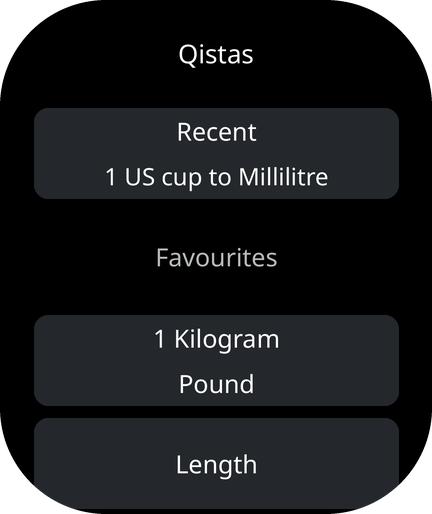
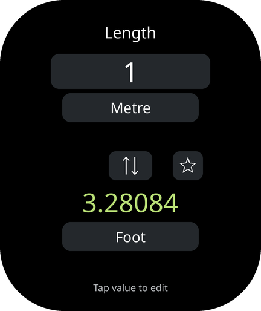
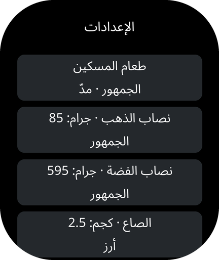
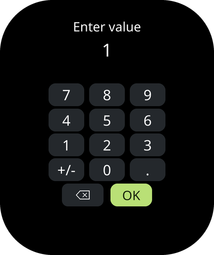
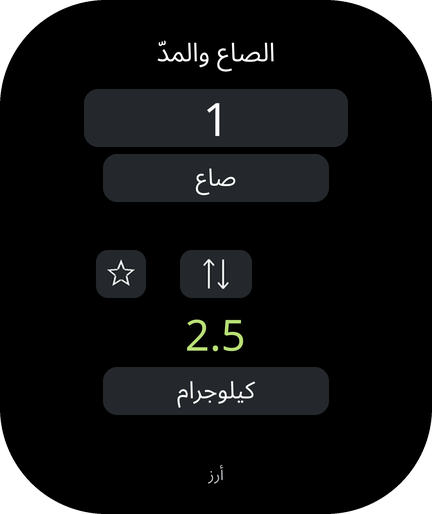
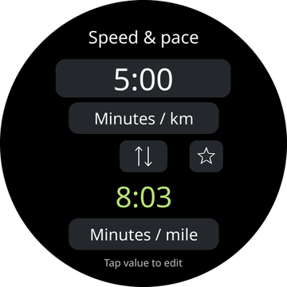
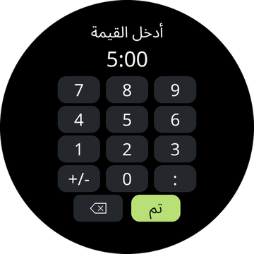

# Qistas (قسطاس)

An offline units converter for Zepp OS 3+ watches, including the Amazfit Bip Max. Arabic and English follow the watch language. Both use Western digits (`0–9`) and `.` by default; Settings → **Arabic-Indic digits** / **أرقام هندية (١٢٣)** optionally switches values, keypad keys and numeric unit labels to `٠–٩` and `٫`, independently of language. No account, phone component, network, currency rates or permissions beyond screen information and local storage. Works with Gadgetbridge.

| Bip Max · English | Bip Max · العربية |
|---|---|
|  |  |
|  |  |
|  |  |

| Round · English | Round · العربية |
|---|---|
|  |  |

## Using it

- Home is one native vertically scrolling list: a **Recent** / **الأخيرة** shortcut with the latest conversion underneath, then favourites (only when present), categories and Settings. The shortcut is hidden when history is empty, so on a fresh install the categories come first.
- **Recent** opens its own screen with the last **ten conversion pairs**, newest first. Tap one to reopen it; reusing a pair moves its latest value to the front (ingredients are remembered separately). **Clear** / **مسح** at the bottom empties only this history and returns home, without a confirmation. Older saved three-entry histories still load unchanged. Swipe up/down to move through any list; the watch's back gesture leaves the screen. Round-screen rows can clip near the edges but are fully readable in the middle, including the final row.
- Pick length, weight, cooking volume, ingredients, temperature (including oven gas marks), speed and running pace, area, fuel economy, pressure, energy or Islamic measures. Egyptian units include land feddan/qirat/sahm, weight ratl/oqqa/kantar and dry-volume ardeb/kila/qadah.
- Tap the large input to open the **pre-filled keypad**. Enter digits, decimal point, sign or backspace, then **OK**; leaving without OK discards the edit. There are no steppers.
- **Ingredients:** tap the extra ingredient pill to pick flour, sugar, packed brown sugar, unsifted powdered sugar, dry rice, butter, vegetable oil, honey, fresh milk, water, semolina flour or cocoa. Convert US/metric cups and US spoons to grams/ounces; the chosen ingredient stays with each favourite/recent conversion.
- **Fuel:** km/L, L/100 km and US/UK mpg. Zero has no finite reciprocal consumption and shows `—`.
- **Oven gas marks:** enter `0.25`, `0.5` or a whole mark from 1 to 9. Temperature-to-mark conversion picks the nearest conventional table entry (ties upward); values outside the table show `—`. Ordinary °C/°F/K conversions remain exact affine conversions.
- Tap either unit pill to choose its unit. The arrows **swap the units, keeping the input value**. Results update immediately.
- The star pins/unpins the current pair and value. Favourites, last pair/value, last ten conversion pairs and opinion settings stay in LocalStorage on the watch.
- **Pace uses minutes:seconds**, for example `5:00` per km converts to `8:03` per mile. The pace keypad replaces the decimal point with a colon and validates seconds from 0 to 59. Results round to the nearest second with carry into minutes; saved values remain numeric minutes internally without losing conversion precision, and favourites/recents display `m:ss`. Zero speed has no finite pace; zero/negative pace and temperatures below absolute zero show `—`.
- **Islamic measures** offers separate **Gold** and **Silver** groups (including gold karat weights and explicit Islamic dinar/dirham units), saʿ/mudd, crop wasq/nisab, fidya/kaffara food portions and distances. Uqiyah and Sunnah mahr are silver weights, available only in **Silver**. **Food per poor person** in Settings selects one mudd or half a saʿ; all food amounts follow that choice and the selected saʿ mass. Qasr distance remains a unit in the distances converter; its estimate is selected only in **Settings → Qasr**, like saʿ and nisab.
- **Settings**, after the categories, selects each scholarly estimate independently and remembers the optional digit style. A selected option is highlighted. The watch shows only short labels such as Majority, Hanafi, Precaution, Rice or Wheat; scholar names, institutions, methods and URLs are kept in the source table below. Saʿ converter footnotes show only the grain where known; these masses are not universal volume-to-mass factors.

## Definitions and precision

`lib/units.js` contains pure conversion logic and exact defined factors. Length is based on **1 inch = 0.0254 m**, foot = 12 inches, yard = 3 feet, mile = 1760 yards. Mass uses **1 lb = 0.45359237 kg**, 16 ounces/lb and 14 lb/stone. Area factors are the squares of the length definitions, 43560 square feet/acre and 10000 m²/hectare. See [NIST, SI conversion factors](https://www.nist.gov/pml/special-publication-811/nist-guide-si-appendix-b8).

Cooking volume distinguishes **US customary liquid**, metric and UK imperial measures:

| Unit | mL |
|---|---:|
| US cup / pint / fluid ounce | 236.5882365 / 473.176473 / 29.5735295625 |
| US teaspoon / tablespoon | 4.92892159375 / 14.78676478125 |
| Metric cup | 250 |
| UK cup / pint / fluid ounce | 284.130625 / 568.26125 / 28.4130625 |
| Metric/modern UK teaspoon / tablespoon | 5 / 15 |

Egyptian land area uses the supplied rounded metric values: **1 feddan = 4200.83 m²**, **1 qirat (land) = 175.035 m²**, **1 sahm = 7.293 m²**. The traditional relations are 24 qirat/feddan and 24 sahm/qirat (576 sahm/feddan); these independently rounded factors reproduce those relations approximately, not bit-for-bit. Land qirat is explicitly named to distinguish it from gold karats.

US liquid measures derive from the 231 cubic inch gallon; the UK pint is one eighth of the 4.54609 L imperial gallon. The UK cup here is half an imperial pint. Spoons marked Metric/UK are modern **5/15 mL kitchen measures**, not historical imperial spoons. Dry measures and ingredient density conversions are not included.

Temperature uses `°F = °C × 9/5 + 32` and `K = °C + 273.15`. Speed uses 3600 seconds/hour and the international nautical mile of exactly 1852 m. Calculations retain JavaScript floating-point precision; display rounds to six significant digits, removes trailing fractional zeros and expands small/large values as plain decimals or rounded integers without exponent notation (for example `0.000001`).

## Islamic measures and sources

These are scholarly estimates, **not a fatwa or a monetary zakat calculator**. Gold weights support 24, 22, 21, 18, 14, 12 and 9 karats; each gram contains `karat / 24` grams of pure gold. **Gold** opens on **Gram 21k → Gram 24k**; **Silver** opens on **Islamic dirham → Gram**. Gold and silver are distinct substances: cross-metal pairs are rejected, not treated as a currency or purity conversion. For example, 100 g of 21k gold equals 87.5 g of pure (24k) gold, or `87.5 / 85` of the default gold nisab. Each metal has its own Gram and Tola units; Mithqal and Islamic dinar are gold-only, while Islamic dirham, Uqiyah and Sunnah mahr are silver-only. Islamic dinar is explicitly 4.25 g gold (the same mass as a mithqal), and Islamic dirham is 2.975 g silver: the default thresholds are **20 dinars** and **200 dirhams**. Conversions stay within the selected metal; no gold/silver exchange rate is implied. Nisab is shown as a mass, not today's currency value. Choosing an alternative nisab changes only that metal's threshold mass, not its fixed dinar/dirham/tola definitions; the 20-dinar/200-dirham identities apply to the default thresholds. Settings affect the relevant conversion factors; changing the mil estimate does not silently change the separately selected travel-distance opinion.

| Measure | Value | Source / method (documentation only) |
|---|---|---|
| Mithqal | 4.25 g | [Qatar Charity](https://www.qcharity.org/en/qa/zakat/fatwa/details?Sid=12220), 20 mithqal = 85 g gold |
| Islamic dinar | 4.25 g gold | Same mass as a mithqal; 20 dinars = 85 g gold, [Qatar Charity](https://www.qcharity.org/en/qa/zakat/fatwa/details?Sid=12220) |
| Islamic dirham | 2.975 g silver | [Qatar Charity](https://www.qcharity.org/en/qa/zakat/fatwa/details?Sid=12220), 200 dirham = 595 g silver |
| Tola | 11.664 g | [Islamic Relief Australia](https://islamicrelief.org.au/our-work/islamic-giving/nisab/), subcontinent tola definition |
| Gold nisab (default) | 85 g | Majority, 20 mithqal; [Qatar Charity](https://www.qcharity.org/en/qa/zakat/fatwa/details?Sid=12220) and [SeekersGuidance](https://seekersguidance.org/answers/shafii-fiqh/how-is-zakat-on-wealth-calculated-shaykh-dr-muhammad-abu-bakr-badhib/) |
| Gold nisab | 87.48 g | Hanafi/subcontinent, 7.5 tola; [Islamic Relief Australia](https://islamicrelief.org.au/our-work/islamic-giving/nisab/) and [Darul Uloom TT](https://darululoomtt.net/?p=23595) |
| Silver nisab (default) | 595 g | Majority, 200 dirham; [Qatar Charity](https://www.qcharity.org/en/qa/zakat/fatwa/details?Sid=12220) and [SeekersGuidance](https://seekersguidance.org/answers/shafii-fiqh/how-is-zakat-on-wealth-calculated-shaykh-dr-muhammad-abu-bakr-badhib/) |
| Silver nisab | 612.36 g | Hanafi/subcontinent, 52.5 tola; [Islamic Relief Australia](https://islamicrelief.org.au/our-work/islamic-giving/nisab/) and [Darul Uloom TT](https://darululoomtt.net/?p=23595) |
| Saʿ (default) | **2.5 kg** | Rice, Hani al-Jubair's note dated 28 Ramadan 1440: four mudd calibrated by transmission to the Prophetic mudd, through Muhammad ibn Subayyil, Abd al-Wakil al-Hashimi, Yahya al-Mudarris and others; note supplied by the app's owner, no public URL available |
| Saʿ | 2.04 kg | Wheat, the majority (Maliki, Shafiʿi, Hanbali) figure: 5⅓ ratl = 685 5/7 dirham × 2.975 g ≈ 2040 g; Ibn Uthaymeen weighed 2.04 kg of good wheat ([Fatawa al-Islam al-Yawm 15/380](https://shamela.ws/book/894/7534)); also [Dar al-Ifta Egypt](https://www.dar-alifta.org/ar/articles/details/10007) |
| Saʿ | 2.1 kg | Rice, Ibn Uthaymeen's measurement; [IslamQA 49793](https://islamqa.info/ar/49793) |
| Saʿ | 3 kg | Ibn Baz, precaution; [fatwa 13279](https://binbaz.org.sa/fatwas/13279) |
| Saʿ | 3.25 kg | Hanafi (Egypt): 8 Iraqi ratl with a 3.125 g dirham; a full saʿ for dates or barley, half (1.625 kg) for wheat or raisins, [Dar al-Ifta Egypt, fatwa 394](https://www.dar-alifta.org/ar/fatwa/details/11208) |
| Saʿ | 3.18 kg | Hanafi (South Asia): twice Mufti Online's 1.592 kg half saʿ of wheat; Deoband's figure is close (≈3.15 kg). The gap from 3.25 kg is the dirham's weight ([Deoband](https://islamqa.org/hanafi/darulifta-deoband/109692/what-is-the-fidyah-for-an-elderly-person-who-is-close-to-death-and-fasting/), [Mufti Online](https://islamqa.org/hanafi/muftionline/95547/amount-of-sadaqatul-fitr/)) |
| Mudd | Saʿ ÷ 4 (default 0.625 kg) | Four mudd per saʿ; derived from the selected grain/estimate above |
| Wasq | 60 saʿ (default 150 kg) | [IslamQA 36778](https://islamqa.info/en/answers/36778), explicitly sixty saʿ per wasq |
| Crops nisab | 5 awsuq = 300 saʿ (default 750 kg) | [IslamQA 36778](https://islamqa.info/en/answers/36778), [Bukhari 1484](https://sunnah.com/bukhari:1484); the selected grain-dependent saʿ mass applies |
| Uqiyah | 40 Islamic dirhams = 119 g silver | [IslamQA 3119](https://islamqa.info/en/answers/3119), citing Ibn Khaldun's forty-dirham uqiyah |
| Sunnah mahr | 500 dirhams = 1487.5 g silver | [Muslim 1426](https://sunnah.com/muslim:1426), twelve uqiyah and a half; [IslamQA 3119](https://islamqa.info/en/answers/3119) |
| Food per person: Majority preset | 1 mudd = ¼ selected saʿ | [Islamweb 2022](https://www.islamweb.net/ar/fatwa/2022), one mudd of local staple food per poor person |
| Food per person: Hanafi preset | ½ selected saʿ | [SeekersGuidance, Hanafi fasting guide](https://seekersguidance.org/answers/hanafi-fiqh/the-complete-guide-to-fasting/), half a saʿ of wheat/similar grains in the feeding option |
| Fidya (1 day) | 1 person's selected food portion (default 0.625 kg) | [Islamweb 6673](https://www.islamweb.net/ar/fatwa/6673), feeding one poor person per day when applicable |
| Oath kaffara | 10 selected food portions (default 6.25 kg) | [Islamweb 2022](https://www.islamweb.net/ar/fatwa/2022), ten poor people; Quran 5:89 |
| Fast kaffara | 60 selected food portions (default 37.5 kg) | [Bukhari 1936](https://sunnah.com/bukhari:1936), feeding sixty poor people in the specified expiation |
| Dhiraʿ | 48 cm | [Dar al-Ifta Egypt 8831](https://www.dar-alifta.org/ar/fatwa/details/22385), citing al-Kurdi, *al-Maqadir al-Sharʿiyya* |
| Mil (default) | 1.68 km | 3500 dhiraʿ; [Dar al-Ifta Egypt 8831](https://www.dar-alifta.org/ar/fatwa/details/22385) |
| Mil | 1.85 km | Hanafi, [Islamic Portal](https://islamqa.org/hanafi/islamicportal/118153/travel-distance-48-miles-or-54-5-miles/) |
| Mil | 1.92 km | Derived alternative: 4000 × the selected fixed 48 cm dhiraʿ; [Dar al-Ifta Egypt 8831](https://www.dar-alifta.org/ar/fatwa/details/22385), discussion of mil definitions |
| Farsakh | 3 mil | [Dar al-Ifta Egypt 8831](https://www.dar-alifta.org/ar/fatwa/details/22385); derived from the selected mil |
| Barid | 4 farsakh | [Dar al-Ifta Egypt 8831](https://www.dar-alifta.org/ar/fatwa/details/22385); derived from the selected mil |
| Qasr travel distance (default) | 80.64 km | Majority, 48 mil at 1.68 km; [Dar al-Ifta Egypt 8831](https://www.dar-alifta.org/ar/fatwa/details/22385) |
| Qasr travel distance | 80 km | Saudi Permanent Committee; [IslamQA 38079](https://islamqa.info/ar/38079) |
| Qasr travel distance | 81 km | Hanafi, three days' travel; [Dar al-Ifta Egypt 8831](https://www.dar-alifta.org/ar/fatwa/details/22385) |
| Qasr travel distance | 88.8 km | Hanafi, [Islamic Portal](https://islamqa.org/hanafi/islamicportal/118153/travel-distance-48-miles-or-54-5-miles/) |
| Qasr travel distance | **Approximately 77 km** | Some Indian Hanafi estimates using 48 English miles; [Islamic Portal](https://islamqa.org/hanafi/islamicportal/118153/travel-distance-48-miles-or-54-5-miles/) |

Sources:
- [Qatar Charity, nisab](https://www.qcharity.org/en/qa/zakat/fatwa/details?Sid=12220) and [SeekersGuidance](https://seekersguidance.org/answers/shafii-fiqh/how-is-zakat-on-wealth-calculated-shaykh-dr-muhammad-abu-bakr-badhib/).
- [Islamic Relief Australia, tola nisab](https://islamicrelief.org.au/our-work/islamic-giving/nisab/) and [Darul Uloom TT](https://darululoomtt.net/?p=23595).
- [IslamQA 49793, saʿ estimates and grain dependence](https://islamqa.info/ar/49793); [Ibn Baz 13279, precautionary 3 kg](https://binbaz.org.sa/fatwas/13279).
- [Dar al-Ifta Egypt 8831, distances](https://www.dar-alifta.org/ar/fatwa/details/22385); [IslamQA 38079, Permanent Committee](https://islamqa.info/ar/38079); [Islamic Portal, Hanafi distance opinions](https://islamqa.org/hanafi/islamicportal/118153/travel-distance-48-miles-or-54-5-miles/).

A saʿ is a volume measure: its mass depends on the grain and packing. The 2.5 kg default specifically represents the cited rice measurement, not a claim of consensus. Mudd is always one quarter of the selected saʿ. The 77 km option is intentionally approximate, not the exact 77.248512 km conversion of 48 English miles.

### Scope of the food presets

Fidya and kaffara are **food-quantity multipliers, not rulings about who owes them or which expiation option is available**. The fasting narration concerns intercourse during a Ramadan fast and the sequence of alternatives; the app does not determine eligibility or replace those conditions. The Hanafi source specifies wheat/similar grains and gives its own approximate saʿ calibration. Here both presets deliberately use the **user-selected saʿ mass**, as configurable portion conventions, not a claim that every school uses the same amount for every food or case. These are not cash calculations.

## Additional everyday definitions and checked sources

### Ingredient weight chart

All gram amounts below are from the **gram column** of [King Arthur Baking's published ingredient chart][ingredient-chart], checked directly. They are cooking estimates, not exact physical densities: packing, grain type and measuring technique matter. In particular its milk/water cup is **227 g**; this is the chart's baking convention, not a claim that a physically exact 236.5882365 mL cup of water weighs 227 g. The source's rounded ounce column is not used; the converter retains the exact avoirdupois ounce.

| Ingredient | g per chart US cup | Published entry / source |
|---|---:|---|
| All-purpose flour | 120 | 1 cup, 120 g — [chart][ingredient-chart] |
| Granulated white sugar | 198 | 1 cup, 198 g — [chart][ingredient-chart] |
| Brown sugar | 213 | Packed, 1 cup, 213 g — [chart][ingredient-chart] |
| Powdered sugar | 113 | Confectioners', unsifted, 1 cup, 113 g — [chart][ingredient-chart] |
| Rice | 198 | Long-grain, dry, ½ cup = 99 g — [chart][ingredient-chart] |
| Butter | 226 | 8 tbsp / ½ cup = 113 g — [chart][ingredient-chart] |
| Oil | 198 | Vegetable oil, 1 cup, 198 g — [chart][ingredient-chart] |
| Honey | 336 | 1 tbsp = 21 g, multiplied by 16 — [chart][ingredient-chart] |
| Milk | 227 | Fresh milk, 1 cup, 227 g — [chart][ingredient-chart] |
| Water | 227 | 1 cup, 227 g — [chart][ingredient-chart] |
| Semolina | 163 | Semolina flour, 1 cup, 163 g — [chart][ingredient-chart] |
| Cocoa | 84 | Unsweetened cocoa, ½ cup = 42 g — [chart][ingredient-chart] |

| Ingredient unit | Mass rule | Source |
|---|---|---|
| US cup | Listed grams per cup | [Ingredient chart][ingredient-chart] |
| Metric cup (250 mL) | Listed grams × 250 / 236.5882365 | Ratio to the defined US cup, using the same ingredient estimate; [NIST volume definitions][nist-b9] |
| US tbsp | Listed grams / 16 | Chart's 8 tbsp = ½ cup relation; [ingredient chart][ingredient-chart] |
| US tsp | Listed grams / 48 | Three US tsp per tbsp, US customary definitions; [NIST][nist-b9] |
| Gram | 1 g | SI gram; [NIST][nist-b9] |
| Ounce | 28.349523125 g | Exact international avoirdupois pound / 16; [NIST][nist-b9] |

### Fuel, pressure and energy

| Unit | Definition used | Source |
|---|---|---|
| km/L | Base fuel economy unit | Distance / volume; [NIST][nist-b9] |
| L/100 km | `100 / (km/L)`, reciprocal; zero invalid | [NIST fuel-consumption table][nist-b9] |
| mpg (US) | `1.609344 / 3.785411784` km/L | International mile and 231 cubic inch US gallon; [NIST][nist-b9] |
| mpg (UK) | `1.609344 / 4.54609` km/L | International mile and exact imperial gallon; [NIST][nist-b9] |
| bar | 100000 Pa | [NIST pressure table][nist-b9] |
| psi | 6894.757293168 Pa | Standard pound-force / square inch; NIST's rounded table value is 6894.757 Pa, with the implementation derived from exact 0.45359237 kg, 9.80665 m/s² and 0.0254 m; [NIST][nist-b9] |
| kPa | 1000 Pa | SI kilo prefix; [NIST][nist-b9] |
| atm | 101325 Pa | Standard atmosphere, not technical atmosphere; [NIST][nist-b9] |
| kcal | 4184 J | Thermochemical food kilocalorie, not the IT calorie; [NIST energy table][nist-b9] |
| kJ | 1000 J | SI kilo prefix; [NIST][nist-b9] |
| kWh | 3600000 J | Kilowatt × 3600 seconds; [NIST energy table][nist-b9] |

### Conventional UK oven table

The Celsius column follows the **non-fan** [BBC Good Food table][gas-c], which [Which?](https://www.which.co.uk/reviews/built-in-ovens/article/oven-temperature-conversion-table-aA5Ol9b157On) matches (gas 3 = 160°C; some charts say 170°C). The Fahrenheit series follows the published cooking equivalents ([Guardian, marks 1–9][gas-f]; [fractional marks][gas-fractions]). Sources differ in rounded Celsius recommendations, so these are **conventional recipe settings**, not exact thermometry: gas 4 is 180°C or 350°F in the table even though an exact 180°C converts to 356°F. Celsius/Fahrenheit/Kelvin without gas marks still use exact formulae. Nearest-mark selection is measured in the input scale, ties choose the higher mark; supported ranges are 110–240°C and 225–475°F inclusive. No extrapolation, fan adjustment or gas 10.

| Gas mark | °C | °F | Source |
|---|---:|---:|---|
| 0.25 | 110 | 225 | [BBC][gas-c], [fractional table][gas-fractions] |
| 0.5 | 120 | 250 | [BBC][gas-c], [fractional table][gas-fractions] |
| 1 | 140 | 275 | [BBC][gas-c], [Guardian][gas-f] |
| 2 | 150 | 300 | [BBC][gas-c], [Guardian][gas-f] |
| 3 | 160 | 325 | [BBC][gas-c], [Guardian][gas-f] |
| 4 | 180 | 350 | [BBC][gas-c], [Guardian][gas-f] |
| 5 | 190 | 375 | [BBC][gas-c], [Guardian][gas-f] |
| 6 | 200 | 400 | [BBC][gas-c], [Guardian][gas-f] |
| 7 | 220 | 425 | [BBC][gas-c], [Guardian][gas-f] |
| 8 | 230 | 450 | [BBC][gas-c], [Guardian][gas-f] |
| 9 | 240 | 475 | [BBC][gas-c], [Guardian][gas-f] |

### Traditional Egyptian weight and dry volume

These are the **1891 metric equivalences**, not a claim that every historical/local variant was identical. The [published summary][egypt-measures] cites Washburn's *International Critical Tables* (1926), p. 6, and Cardarelli's *Encyclopaedia of Scientific Units* (2003), pp. 128–130; verification here used that secondary table, not an independently inspected scan of the books.

| Unit | Definition used | Verification / source |
|---|---|---|
| Egyptian ratl | 449.28 g | 0.36 oke × 1.248 kg; [1891 table][egypt-measures] |
| Oqqa / oke | 1.248 kg | Explicit metric equivalence; [1891 table][egypt-measures] |
| Kantar | 100 ratl = 44.928 kg | 36 oke × 1.248 kg; [1891 table][egypt-measures] |
| Qadah / keddah | 2.0625 L | Explicit metric equivalence; [1891 table][egypt-measures] |
| Kila / keila | 1/12 ardeb = 16.5 L | Eight keddah; [1891 table][egypt-measures] |
| Ardeb | 198 L | 96 keddah × 2.0625 L; [1891 table][egypt-measures] |

An **ardeb is volume**, not a universal crop weight: kilograms depend on the crop and packing. The ordinary international pound is labelled **باوند**, while the traditional Egyptian unit is **رطل مصري**.

[ingredient-chart]: https://www.kingarthurbaking.com/learn/ingredient-weight-chart
[nist-b9]: https://www.nist.gov/pml/special-publication-811/nist-guide-si-appendix-b-conversion-factors/nist-guide-si-appendix-b9
[gas-c]: https://www.bbcgoodfood.com/conversion-guides
[gas-f]: https://www.theguardian.com/lifeandstyle/2007/nov/24/foodanddrink.baking6
[gas-fractions]: https://en.wikipedia.org/wiki/Gas_mark#Gas_marks_and_temperatures
[egypt-measures]: https://en.wikipedia.org/wiki/Egyptian_units_of_measurement

All newly added factors above were checked against the linked publications or are explicit arithmetic derivations from them. The saʿ figures are cited in their rows.

## Devices

| Target | Screen | Watches |
|---|---|---|
| `bip-max` | 432 × 514 | Bip Max |
| `square-390x450` | 390 × 450 | Bip 6, Active 2 Square, Active, GTS 4, Cheetah Square |
| `square-320x380` | 320 × 380 | Bip 5 Unity |
| `round-480` | 480 × 480 | Balance 3, Balance Ultra, Cheetah 2 Ultra, T-Rex Ultra 2, Active Max, T-Rex 3 Pro 48 mm, Balance 2, Balance 2 XT, T-Rex 3, Balance, Cheetah Pro |
| `round-466` | 466 × 466 | Cheetah 2 Pro, Active 3 Premium, T-Rex 3 Pro 44 mm, Active 2 Round, GTR 4 |
| `round-454` | 454 × 454 | Cheetah Round, T-Rex Ultra |
| `round-416` | 416 × 416 | Falcon |
| `round-360` | 360 × 360 | Active Edge |

API 3.0. `devices.json` is the authoritative device-ID list; `scripts/targets.py` writes targets into `app.json`. `_pikeCompatibled: 1` gives the Bip Max its real dimensions. Rectangles scale from 360 × 428 and rounds from 360 × 360. All interactive boxes are at least 30 px. Fixed converter/keypad controls fit rounded screens and stay above the round screen's bottom 12.5% swipe zone; scrolling lists use narrow rows that are fully readable in the centre and enough bottom padding to reach the final row. All targets have layout/stub tests; tested on the Bip Max, the other sizes by layout tests and previews only.

## Build and checks

```sh
mise run //qistas:gen          # app ID, targets, icons, eight README screenshots
mise run //qistas:previews     # all 128 screenshots in .cache/previews/qistas/
mise run //qistas:test         # pure logic, stub interactions, every target, package
mise run //qistas:build        # regenerate, test, lean dist/*.zab for Gadgetbridge
mise run //qistas:build-store  # keep source archive for the Zepp store
mise run //qistas:ci           # also check generated outputs against committed files
```

### Conversion QA

`test/pairs.test.js` checks every ordered pair in every category against independent reference data (`test/definitions.js`), plus a→b→a round trips. It repeats the ingredient matrix for each of the 12 ingredients, the food matrix for every saʿ/per-person combination, the metal matrices for each nisab setting, and the Islamic-distance matrix for every mil/qasr combination. Gas marks use table anchors for exact pair round trips, with additional tests for arbitrary temperatures' deliberate quantisation and table edges; reciprocal zero, arithmetic overflow/underflow and strict absolute-zero boundaries are tested separately. No all-pairs test derives its expected numbers from the application's factor function.

Old saved pairs that become invalid after the metal split are discarded during load (including mixed-metal/ambiguous gram pairs), while still-valid favourites and recents are retained. This avoids guessing a metal or retaining meaningless ratios.

App ID **1136625**, registered on the Zepp console, comes from `QISTAS_APP_ID` in the root `mise.toml`. All tool versions, including uv, are inherited from the root `mise.toml`. No runtime dependencies.

`:gen` writes only the eight screenshots shown above and the 240 × 240 `icon.png` to `docs/qistas/`; the root README reuses the converter image. `tools/gen-icon.py` also generates the original balance icon and bitmap control symbols under `assets/<target>/` (no dependence on firmware symbol coverage), plus per-target notices.

`:previews` runs the same `tools/gen-previews.py` with `--all`, writing all 128 screen/state previews in both languages and shapes to `.cache/previews/qistas/` (git-ignored). Both modes run the real pages through `../shared/zos-stub.mjs` and `../shared/widget_draw.py`, and fail on text that exceeds its box. Arabic shaping and bidi use shared preview fonts, not bundled watch fonts. Rectangular previews are Bip Max size; round previews are rendered at 480 then reduced to 360 × 360. `:ci` checks the committed `docs/qistas/` set, not the review cache.

## License

[GPL-3.0](../LICENSE). Original artwork; no third-party fonts or code bundled. See `assets/<target>/NOTICE.txt`.
