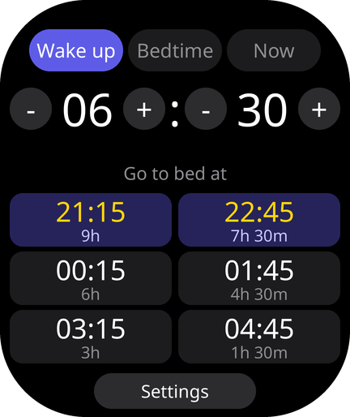
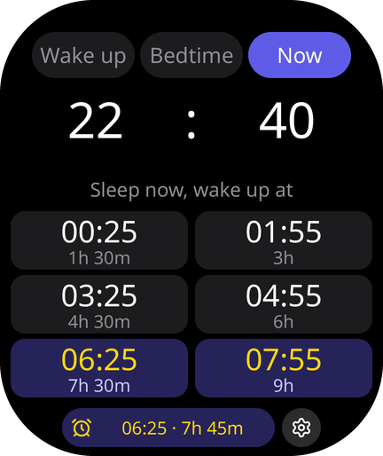
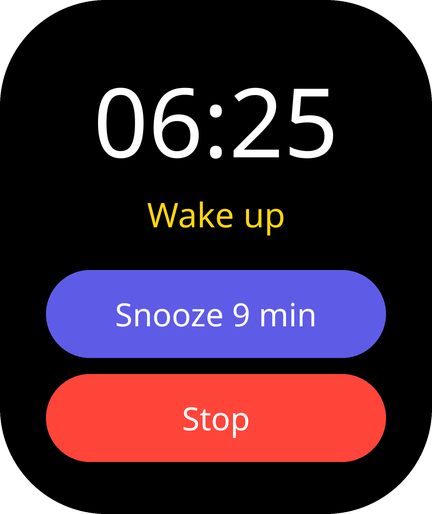
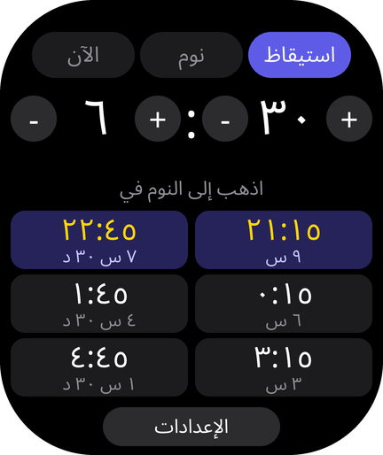
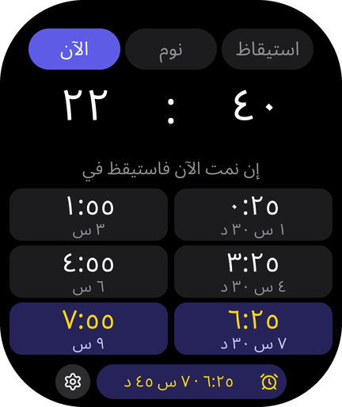
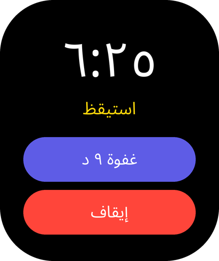

# Sleep Time (وقت النوم)

A sleep-cycle calculator for the **Amazfit Bip Max** and other rectangular and round Zepp OS 3+ watches, such as the Bip 6, Active 2, Balance, T-Rex 3 and GTR 4 (see [Devices](#devices)). Sleep comes in cycles of about 90 minutes, and waking at the end of one feels easier than waking in the middle. Pick when you want to wake up or go to bed, and the watch lists the times that line up with whole cycles. Fully offline; works with Gadgetbridge.

| | | |
|---|---|---|
|  |  |  |
|  |  |  |

## Features

- **Wake up:** set the time you want to wake up with − / + (hours, and minutes in steps of 5); the app lists six bedtimes, from 6 cycles down to 1.
- **Bedtime:** set when you go to bed; the app lists six wake-up times, from 1 cycle to 6.
- **Now:** like Bedtime, from the current time (updated every minute).
- Each result shows the time and how long you'd sleep. **5 and 6 cycles** (7½–9 h at 90 min), the amount most often recommended for adults, are highlighted.
- The time it takes to fall asleep (15 min by default) is added to every result. Times wrap past midnight.
- **Settings:** cycle length (60–120 min), time to fall asleep (0–60 min), clock (the watch's, 24-hour or 12-hour), which mode the app opens in, and snooze length. The last wake-up and bed times you set are remembered.
- **Alarms:** tap a result to be woken at that time; see [Alarm](#alarm).
- English and Arabic, following the watch's language. Arabic mirrors the tabs, results and bottom row, uses Arabic-Indic digits, and writes hours without a leading zero (٦:٢٥).

## Alarm

- **Tap a result** to set an alarm, and confirm it on the next screen (back cancels). In Bedtime and Now modes the result is the wake-up time ("Alarm 06:25 · 7h 30m of sleep"). In Wake up mode the result is a bedtime: the alarm goes at the wake-up time you set, plus a **bedtime reminder** at the tapped time (one short buzz and a "Time to sleep" screen, no ringing).
- **One alarm at a time:** a new one replaces the old one and its reminder. Times are always the next one (today or tomorrow).
- While it's set, the bottom row of the main screen is an **alarm chip** (an alarm-clock icon, "06:25 · 7h 45m": the time and how long until it) and a round **gear** button for Settings. Tap the chip to cancel the alarm. Once it has rung, the row goes back to the Settings button. Mirrored in Arabic: the chip on the right, the gear on the left.
- **Do Not Disturb:** the watch doesn't ring app alarms while Do Not Disturb or Sleep mode is on (both tested on the Bip Max). The confirm screen reads the mode with [`getSystemMode()`](https://docs.zepp.com/docs/reference/device-app-api/newAPI/settings/getSystemMode/) (`@zos/settings`, API 3.0: `DND`, `sleep`, …). If DND is on, it warns that the alarm won't ring and offers **Use watch alarm** (the watch's Alarm app, with the time still on screen to enter there); Sleep mode gets the same warning and button. If the watch doesn't give the mode, a short "Silenced by Do Not Disturb" note and a smaller **Use watch alarm** button are always shown. It reads the mode only when you confirm: Do Not Disturb that turns on later on a schedule isn't caught.
- **Ringing** (`page/ring`): the time, "Wake up", the watch's own alarm vibration (continuous), the screen kept on, and **Snooze** (5, 9, 10 or 15 min, in Settings) and **Stop**. Going back or leaving the page snoozes; only **Stop** ends the alarm. On watches with API 3.6+ and their sounds on, it also plays the system alarm sound. If nobody reacts for 2 minutes it stops and snoozes, at most 3 times in a row; then it stops for good.
- **If the watch refuses the alarm,** the app says so and offers to open the watch's Alarm app, showing the time to set there by hand.
- **Settings → Test alarm in 1 minute** sets a real alarm a minute ahead: the way to check alarms on your watch.

### How alarms work, and their limits

Zepp OS has no API to add an alarm to the watch's Alarm app. The app uses [`@zos/alarm`](https://docs.zepp.com/docs/reference/device-app-api/newAPI/alarm/set/) (API 3.0, permission `device:os.alarm`) instead: a timer that reopens one of the app's pages at a set time, kept across reboots (`store: true`). That page rings by itself with [`Vibrator`](https://docs.zepp.com/docs/reference/device-app-api/newAPI/sensor/Vibrator/) (`VIBRATOR_SCENE_TIMER`, the watch's alarm pattern) and keeps the screen on (`setPageBrightTime`, `pauseDropWristScreenOff`). The sound uses [`SystemSounds`](https://docs.zepp.com/docs/reference/device-app-api/newAPI/sensor/SystemSounds/), which needs API 3.6; the app checks for it at run time.

Zepp's docs don't say what happens when the screen is off, the app is closed, after a reboot, or in Do Not Disturb or Sleep mode. On the Bip Max, the test alarm rings normally, and **doesn't ring at all with Do Not Disturb or Sleep mode on**. A developer reported a timer that never reopened the app on Zepp OS 3.5 ([discussion](https://github.com/orgs/zepp-health/discussions/355)), and another Bip Max alarm app reports that the watch's Sleep mode and Do Not Disturb hold back app alarms and their vibration ([README](https://github.com/brzewVCE/amazfit-smart-alarm)). **Until it has worked on your watch, don't rely on it alone.**

### Testing on the watch

Each step: Settings → **Test alarm in 1 minute**, check "Alarm set", then:

1. **Screen off:** let the screen go off with the app open. After a minute it should light up, vibrate and show "Wake up". Tap **Snooze** (or go back): it should ring again after the snooze time. Tap **Stop**.
2. **App closed:** leave the app (back to the watch face), wait. Same result expected; also check the 2-minute auto-snooze by not touching it (it stops, says "Snoozed until …", and rings again later).
3. **Do Not Disturb on** (doesn't ring on the Bip Max; the confirm screen should warn), then **Sleep mode on** (doesn't ring either; the confirm screen should warn): repeat 2 for each.
4. **After a reboot:** set a test alarm (or a real one 5 minutes ahead), restart the watch, wait.
5. **Bedtime reminder:** in Wake up mode, set the wake time and tap a bedtime a few minutes ahead; at that time there should be one buzz and "Time to sleep".

If a step doesn't ring, the alarm can't be trusted in that state; please report it with the watch model and firmware.

## Setup

1. Install the `.zab` (open it with Gadgetbridge).
2. Open **Sleep Time** on the watch. **Settings** is at the bottom of the main screen.

## How it works

- `lib/sleep.js` holds the maths, the time and duration text, and the settings' defaults and checks; it has no `@zos` imports, so `test/sleep.test.js` runs it in Node. Results are `wake − fall − n·cycle` (Wake up) or `bed + fall + n·cycle` (Bedtime, Now), in minutes modulo a day, n = 1…6.
- `lib/layout.js` has every box of every page, designed for the Bip Max's 432 × 514 screen and scaled for the others. Pages: `page/index.js` (main), `page/settings.js`, `page/alarm.js` (confirm, result, cancel, fallback), `page/ring.js` and `page/remind.js` (opened by the timers); `lib/ui.js` has their widget helpers and colours.
- `lib/alarms.js` sets, replaces, snoozes and cancels the timers, and keeps their ids and times (`test/alarms.test.js`, on stub `@zos/alarm`, `@zos/sensor` and `@zos/storage`).
- `lib/env.js` reads the screen (`getDeviceInfo()`), language (`getLanguage()`: Arabic or English) and the watch's clock format once.
- **Storage:** in LocalStorage, the settings with the last wake-up and bed times (`lib/store.js`), and the alarm's timer ids and times (`lib/alarms.js`). A missing or broken value falls back to the default.
- **Permissions:** `data:os.device.info` (screen size), `device:os.local_storage` and `device:os.alarm`. No network, no phone side.

## Devices

| Target | Screen | Watches (deviceSource) | Tested |
|---|---|---|---|
| `bip-max` | 432 × 514 | Bip Max (11206915) | on the watch: the test alarm rings, not with Do Not Disturb on; the rest by tests and previews |
| `square-390x450` | 390 × 450 | Bip 6, Active 2 (Square), Active, GTS 4, Cheetah (Square) (14 ids, in `app.json`) | layout tests only |
| `square-320x380` | 320 × 380 | (3 ids, in `app.json`; the watchface's) | layout tests only |
| `round-480` | 480 × 480 | Balance 3, Balance Ultra, Cheetah 2 Ultra, T-Rex Ultra 2, Active Max, T-Rex 3 Pro 48 mm, Balance 2, T-Rex 3, Balance, Cheetah Pro (37 ids) | layout tests and previews only |
| `round-466` | 466 × 466 | Cheetah 2 Pro, Active 3 Premium, T-Rex 3 Pro 44 mm, Active 2 (Round), GTR 4 (24 ids) | layout tests only |
| `round-454` | 454 × 454 | Cheetah (Round), T-Rex Ultra (4 ids) | layout tests only |
| `round-416` | 416 × 416 | Falcon (2 ids) | layout tests only |
| `round-360` | 360 × 360 | Active Edge (2 ids) | layout tests only |

The app targets API 3.0 (`@zos/alarm` needs 3.0), which every model above has. Device ids and model names are in the repo's `devices.json`.

Rectangles are scaled from the Bip Max design (x by width, y by height, text by the smaller). Round screens (`width === height`) have their own design at 480 × 480, scaled evenly, as the watchface does: tabs in a short row near the top, the steppers in the wide middle, the 2 × 3 results grid where the circle is wide enough for it, and the bottom row (Settings, or the alarm chip and gear) above the bottom 60 px, where the swipe-up gesture starts. `test/layout.test.js` checks, for every target, both directions and both bottom-row states, that every drawn box on every page fits inside the screen (the circle, or the rounded rectangle; 1.5 px allowed for rounding), that buttons don't overlap, that none is under 30 px (the smallest: 360 × 360's settings rows), and on round screens that nothing tappable is in the bottom 60 px. Full round previews: `.cache/previews/sleep-time/round-<page>-<lang>.png` from `:previews` (480 design, reduced to 360 × 360; not committed). To add a screen: add `"<key>": {}` to the `app.json` targets (a key of the repo's `devices.json`, which has its screen, corner radius and device ids; `:gen` fills them in), copy `assets/bip-max/NOTICE.txt` into `assets/<target>/`, and run `mise run :build`.

## Build

```sh
mise run //sleep-time:gen           # icons and the six README screenshots
mise run //sleep-time:previews      # all 24 screenshots in .cache/previews/sleep-time/
mise run //sleep-time:build         # tests, icon, README previews, lean .zab in dist/
mise run //sleep-time:build-store   # keeps zeus's source archive, for a store submission
mise run //sleep-time:ci            # what CI runs: also fails if the committed icon or previews are stale
```

`:gen` runs `tools/gen-icon.py` (`assets/<target>/icon.png`, the store's 240 × 240 `docs/sleep-time/icon.png`, and the chip and gear icons in `assets/<target>/icons/`, drawn from Lucide's icon font at each screen's size) and `tools/gen-previews.py`. Only the six Bip Max screenshots shown above (`<lang>-{wake,now,ring}.png`, English and Arabic) and `icon.png` are written to `docs/sleep-time/`; the root README reuses the wake image.

`:previews` runs the same generator with `--all` and writes all 24 screenshots (six screens/states × two languages × two shapes) to `.cache/previews/sleep-time/`, which is git-ignored. This includes Settings, alarm confirmation with DND unknown/on and every round preview. Both modes run the real pages on stub `@zos` modules (`tools/preview-data.mjs`, `tools/zos-stub.mjs`), draw with `../shared/widget_draw.py` and fail if text exceeds its box. `:ci` still checks the committed `docs/sleep-time/` set, not the review cache. `test/pages.test.js` drives the same pages through the stub: steppers, tabs, settings, setting and cancelling an alarm, the fallback, the Do Not Disturb notice, ringing, snooze, back = snooze and auto-snooze.

**App ID:** 1136529, registered on the Zepp console. It lives in the root `mise.toml` `[env]` (`SLEEP_TIME_APP_ID`); `:gen` writes it into `app.json` (`scripts/app-ids.py`).

## License

[GPL-3.0](../LICENSE). The package bundles no third-party code, fonts or data, except two [Lucide](https://lucide.dev) icons (ISC; `assets/<target>/NOTICE.txt`).
